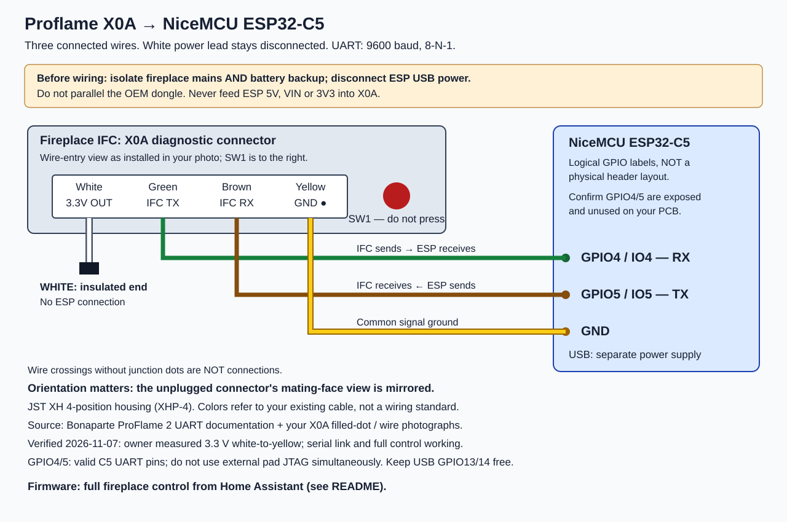

# Proflame ESP32 fireplace controller (basement)

A NiceMCU ESP32-C5 running ESPHome that controls James's **basement** Proflame 2
fireplace through the controller's X0A diagnostic serial port, and exposes it
to Home Assistant as **Basement Fireplace**.

**History:** it was first built and commissioned on the living room fireplace
(2026-11-06/07). The living room controller turned out to be the newer
"Connect" board, so the original SIT Proflame Connect dongle went back there
(controlled by the `proflame_connect_wifi` integration), and the ESP32 moved to
the basement fireplace, whose older controller cannot power the dongle.

| | |
| --- | --- |
| Fireplace | Montigo P52DF-F (natural gas), basement |
| Controller | Proflame 2 IFC, **older board**: X0A supply 3.24 V (regulated, unchanged with fresh batteries); answers registers 0x00–0x18 only |
| Board | NiceMCU ESP32-C5 (chip rev 1.0, 4 MB flash, native USB), USB-powered |
| Firmware | [esphome/proflame-bench.yaml](esphome/proflame-bench.yaml) + [esphome/ifc_query.h](esphome/ifc_query.h), ESPHome 2026.10.2 |
| HA device | **Basement Fireplace** (`proflame-bench`), Basement area, entities `*.basement_fireplace_*`; encrypted API, Wi-Fi logs, password OTA |
| Wi-Fi | **−90 to −92 dBm** at the basement fireplace: unreliable; move the board or add an access point |

### Supply voltages (corrected)

| Controller | X0A white → yellow | Notes |
| --- | --- | --- |
| Living room (newer, Connect board) | **6.24 V** | Battery-backed (4 AA). Powers the OEM dongle. An earlier "3.3 V" report for this unit was not a real measurement. |
| Basement (older board) | **3.24 V** | Regulated; stays 3.24 V with fresh 6.24 V batteries. Too low for the OEM dongle. |

The white supply wire is never connected to the ESP32 in either case.

## Wiring



| X0A wire (installed view, SW1 on the right) | Function | ESP32-C5 |
| --- | --- | --- |
| White | IFC supply output (basement 3.24 V) | **Not connected**, insulated |
| Green | IFC TX | **GPIO4** (RX) |
| Brown | IFC RX | **GPIO5** (TX) |
| Yellow | Ground | **GND** |

The ESP32 is powered separately over USB. UART 9600 baud, 8-N-1. Disconnect
the OEM dongle (never run both on X0A) and isolate fireplace mains and backup
batteries before touching the harness. Details: [wiring.md](wiring.md).

See [electrical-findings.md](electrical-findings.md) for the measurement history.

## Home Assistant entities

| Entity | Function |
| --- | --- |
| **Thermostat** (climate) | Heat/Off; presets Off, Manual, Thermostat, Smart; target temperature; room temperature |
| **Fireplace** (switch) | On = Manual at the last flame level; Off = everything off |
| **Mode** (select) | Off / Manual / Thermostat / Smart (same behavior as the climate presets) |
| **Flame Height**, **Fan Speed** (numbers, 0–6) | Burner flame and comfort fan |
| **Light** (switch) | IFC AUX relay (the living room light was wired there; basement wiring not yet confirmed) |
| **Light Follows Fireplace** (config switch) | Light turns on/off with the fireplace |
| **Pilot** (select), **Split Flow** (switch) | Continuous/intermittent pilot; split-flow valve |
| Fireplace Status, Thermostat Status, Room Temperature (+ Source) | Status |
| IFC Control, Last Command Result, Control Request Result, IFC Link, raw registers, Remote Room Temperature / Setpoint, Scan IFC Registers | Diagnostics |
| Lamp Output Level (unused) | IFC lamp output; nothing is connected to it here, hidden by default |

## Thermostat

The IFC's own thermostat modes depend on the handheld remote, so Thermostat and
Smart run on the ESP32 (Manual mode cycled on/off; idle = Manual with flame 0 so
fan and light keep running; Smart lowers the flame near target; 5-minute minimum
for automatic cycling; user changes apply immediately; no temperature → off).

**Room temperature source: the basement remote only** (James's decision; the
main floor sensor measured the living room). The remote's reading reaches the
ESP32 only through IFC register 0x1F, and **the basement's older controller
doesn't have that register**. So in the basement, Thermostat/Smart stay off and
Room Temperature Source shows "Unavailable (this controller does not report the
remote temperature)". The remote's own thermostat still works normally. An HA
or ESP32-attached basement temperature sensor would be needed to use it.

Starting Thermostat/Smart (or any other control) requests control from the IFC
automatically when the remote last had it.

## Protocol

Six-byte frames `[cmd, p0, p1, p2, register, XOR]`; GET `5E` → reply `AE`,
SET `5D` → echo `AD`.

| Register | Meaning | Source |
| --- | --- | --- |
| 0x16 | Control ownership. `C1 A0 00` = UART, `00 00 00` = remote | Documented |
| 0x17 | p1: mode bits 0–1 (0 off, 1 manual, 2 thermostat, 3 thermostat+power), undocumented bits 2–3, lamp bits 4–6, pilot bit 7 | Documented; bit layout corrected on this unit |
| 0x18 | p1: flame bits 0–2, AUX bit 3, fan bits 4–6, split flow bit 7 | Documented |
| 0x1E (0x21 mirror) | Remote thermostat setpoint, whole °F | Found by register scan |
| 0x1F | Remote's room temperature report, tenths °F | Found by register scan (provisional) |
| 0x00–0x24 | All answer GET; the rest are not yet identified | Register scan |

Behavior on this IFC:

- Using the remote switches control to the remote; 0x16–0x18 then read all
  zeros, shown in HA as unknown. Commands are refused until the remote turns
  the fireplace off, after which the ESP32 requests control once.
- The IFC echoes a control request even when refusing it. The grant is
  confirmed by the next 0x16 read.
- 0x1E/0x1F read correctly even while the remote has control.

## Firmware safety rules

- Nothing is written at boot or reconnect; background traffic is GET-only
  (the thermostat, when active, sends commands as described above).
- Each command is sent once, never queued or replayed. A command is refused
  while another is running.
- Before writing, the firmware verifies UART control and reads fresh state
  (control checks before and after the state read). Writes change only the
  targeted fields and keep undocumented bits. Every command is confirmed by
  read-back (**Last Command Result**).

## Build, update, test

Device Builder's `secrets.yaml` holds `wifi_ssid`/`wifi_password` and
`proflame_bench_api_key`/`proflame_bench_ota_password` (also in bee2 Secret
Service). No credentials are in this repository.

```sh
# Parser/encoder tests (ASan/UBSan)
g++ -std=c++17 -Wall -Wextra -Werror -fsanitize=address,undefined \
  tests/test_ifc_query.cpp -o /tmp/proflame-test && /tmp/proflame-test
# Build and install over Wi-Fi (needs secrets.yaml next to the YAML)
esphome compile esphome/proflame-bench.yaml
esphome upload esphome/proflame-bench.yaml --device proflame-bench.local
```

[esphome/proflame-usb-only.yaml](esphome/proflame-usb-only.yaml) is a minimal
USB-only image without networking or IFC communication.

## Rollback

Shut down and isolate the fireplace (mains and backup batteries), unplug the
ESP32 harness from X0A, reconnect the original Proflame Connect dongle, restore
power and confirm the remote and the original `proflame_connect_wifi`
integration work.

## Known limitations

- No dimmable lamp on this fireplace (the light is on the AUX relay).
- While the remote has control, HA can't see or control the fireplace.
- The meaning of most registers is still unknown (0x00–0x24 living room, 0x00–0x18 basement).
- Basement Wi-Fi is about −90 dBm; commands may be slow or lost.

## Further documents

- [wiring.md](wiring.md): connector details and sources
- [electrical-findings.md](electrical-findings.md): supply measurements and component research
- [upstream-review.md](upstream-review.md): why the kaechele/esphome-proflame2 component isn't used as-is
- [commissioning.md](commissioning.md), [verification.md](verification.md), [components.md](components.md)
