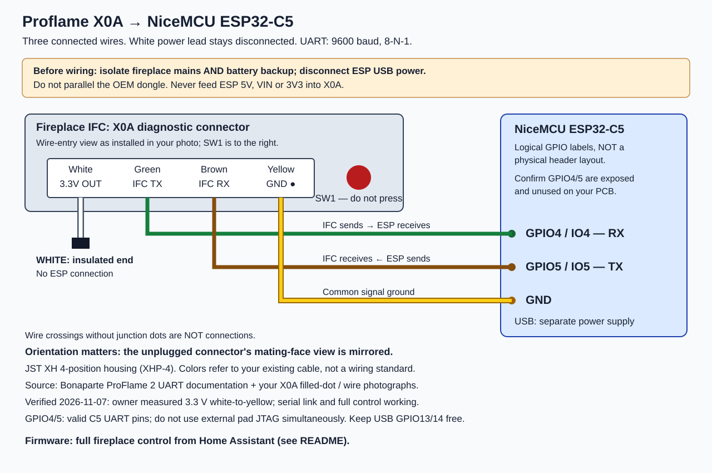

# X0A wiring

**Verified working on 2026-11-07** (Montigo P52DF-F, green-print Proflame 2 IFC).
James measured **3.3 V** white-to-yellow; an earlier 6.26 V reading was a
measurement error and was retracted.

[Open/download the SVG](wiring.svg).

## Connections

Use the board's **GPIO4 / GPIO5** labels, not header positions or D4/D5
aliases. Looking at the installed X0A connector from the wire-entry side, with
the red SW1 button on the right:

| Position left → right | Wire | IFC function | ESP32-C5 |
| --- | --- | --- | --- |
| 1 | White | 3.3 V output | **Not connected**, insulated |
| 2 | Green | TX (IFC output) | **GPIO4** (UART RX) |
| 3 | Brown | RX (IFC input) | **GPIO5** (UART TX) |
| 4, filled-dot end | Yellow | Ground | **GND** |

Power the ESP32 separately over USB; never connect ESP 5V/VIN/3V3 to X0A.
Remove the OEM dongle (never run two transmitters on X0A). Isolate fireplace
mains and backup batteries before connecting or disconnecting the harness.

Fireplace connector housing: **JST XH four-position XHP-4**, nominal 2.5 mm
pitch. Do not substitute a PH/Grove cable or assume replacement wire colors
match. The disconnected plug's mating-face view is mirrored. Do not change
the cavity order based on an unlabelled photo of the opposite end of the cable.

Keep all X0A wires disconnected from the C5 and preserve the OEM installation.
If experimental wiring has already been added, shut down and isolate fireplace
mains and backup batteries according to the manual, and disconnect ESP USB
power before removing it. Do not press SW1 or unpair the remote. No new
fireplace-to-C5 connection is recommended by this document.

## Evidence and limits

The fireplace rating plate identifies **Montigo P52DF-F**, natural gas. The OEM
dongle is **0584526_01**. The photograph shows the green-print IFC and X0A's
rightmost filled dot. Wire colors above are from James's photographs.

- [Montigo XG0681 Wi-Fi installation instructions](https://www.empireinsider.com/wp-content/uploads/2024/06/xg0681-montigo-manual-sit-wifi-full.pdf), pp. 2–3: green-print IFC, SIT 0.584.526 dongle, X0A connection.
- [Bonaparte firsthand reverse engineering](https://bonaparte.readthedocs.io/en/latest/system_information.html#sit-proflame-2-uart-communication): filled dot identifies GND; IFC pinout `3V3 | TX | RX | GND`, 9600–8-N-1.
- [ESPHome Proflame component hardware instructions](https://github.com/kaechele/esphome-proflame2#hardware-setup): XHP-4 and direct crossed UART. Same author as Bonaparte, not independent measurement.
- [Espressif ESP32-C5 datasheet](https://documentation.espressif.com/esp32-c5_datasheet_en.html): GPIO4/5 permit GPIO-matrix UART routing; they are also external JTAG MTCK/MTDO. Do not simultaneously use pad JTAG. Native USB uses GPIO13/14.

The former direct wiring was **source-derived and is now withdrawn**. The loaded
supply measurement contradicts its 3.3 V assumption. Manufacturer sources establish OEM compatibility, not approval of
this DIY interface. Exact signal levels, grounding/isolation requirements and
NiceMCU header assignments have not been measured. The OEM dongle's ISO1/ISO2
markings are consistent with ACPL-074L optocouplers, but that alone neither proves
nor disproves a need for isolation at X0A. Do not energize uncertain wiring based
on color alone; resolve electrical/board differences before connection.

## Firmware

The current firmware ([README](README.md)) provides full control. UART 9600
baud, 8-N-1; RX GPIO4, TX GPIO5.
